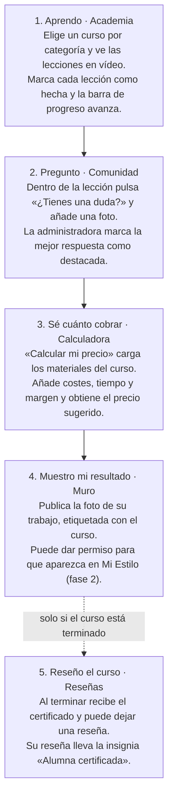
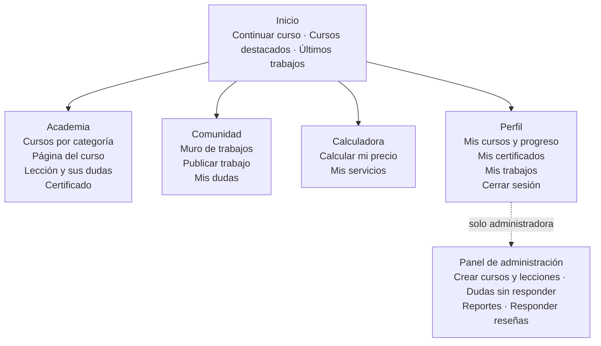

# GLAMIO – Diseño UX/UI

*14 de noviembre de 2026*

## Introducción

El diseño de GLAMIO busca que una alumna pueda completar el recorrido clave **aprendo → pregunto → sé cuánto cobrar → muestro mi resultado** desde   la web y el móvil, sin perderse y en pocos toques.

- **UX (experiencia de usuario):** cómo funciona la app. Quién la usa, qué necesita y en qué orden lo hace.
- **UI (interfaz de usuario):** cómo se ve. Colores, tipografías, botones y tarjetas.

Este apartado cubre la fase 1 (Academia), que es la que se entrega en clase. Mi Estilo (fase 2) y Tienda (fase 3) solo se mencionan cuando afectan a la navegación.

## Usuarios tipo

GLAMIO tiene cuatro perfiles. El diseño se centra en la **alumna**, que es quien hace el recorrido completo en la fase 1.

| Perfil | Ejemplo | Qué necesita | Qué le frustra | Pantallas clave |
| --- | --- | --- | --- | --- |
| **Alumna** (principal) | Lucía, 22 años, empieza en uñas y practica con amigas | Aprender paso a paso, resolver dudas con foto, saber cuánto cobrar | Vídeos largos sin orden, no saber si va bien, poner precios "a ojo" | Academia, lección, calculadora, muro |
| **Profesional** | Marta, 30 años, manicurista con clientas fijas | Aprender técnicas nuevas (cabello, cejas), mostrar trabajos, ajustar precios | Perder tiempo en menús, no tener dónde enseñar su trabajo | Cursos, muro, calculadora, mis servicios |
| **Administradora** | Responsable de la academia | Crear cursos y lecciones, marcar respuestas destacadas, moderar | Paneles confusos, no ver qué dudas faltan por responder | Panel admin, dudas, reportes |
| **Clienta** (fase 2) | Ana, busca ideas para su próxima cita | Ver diseños, guardar favoritos, reseñar a su profesional | Registro largo, demasiada información técnica | Mi Estilo, favoritos |

Por eso la app prioriza: lecciones cortas con progreso visible, dudas dentro de cada lección y una calculadora que se rellena sola con los materiales del curso.

## Recorrido clave y flujos

El flujo principal es el de la alumna, que va de aprender a reseñar en 5 pasos sin salir de la app.



El paso 5 va con línea discontinua porque solo se desbloquea al terminar el curso: así la regla de reseñas se ve también en el diseño.

### Otros flujos

**Administradora: crear un curso**

1. Panel admin → "Nuevo curso": título, categoría, precio o gratis, imagen.
2. Añade lecciones (vídeo propio corto o enlace de YouTube) y la lista de materiales.
3. Publica el curso y aparece en Academia dentro de su categoría.

**Administradora: responder dudas**

1. Panel admin → "Dudas sin responder".
2. Abre la duda dentro de su lección y responde o elige la mejor respuesta.
3. Marca "Respuesta destacada" y la alumna recibe el aviso.

**Cualquier usuaria: reportar contenido**

1. Pulsa "Reportar" en un trabajo o una respuesta y elige el motivo.
2. El contenido se oculta hasta que se revise.
3. La administradora lo restaura o lo elimina desde "Reportes".

## Navegación

La app tiene 4 secciones fijas en el menú inferior y una página de Inicio a la que se vuelve tocando el logo.



El panel de administración solo aparece en el Perfil de la administradora; el resto de perfiles no lo ve. Mi Estilo (fase 2) se añadirá como quinta sección del menú para las clientas.

## Wireframes

Cada pantalla tiene una sola acción principal (marcada con `[[ ]]` en los bocetos), que en la app irá en rosa GLAMIO, para que la alumna sepa siempre qué hacer a continuación.

```text
 1. INICIO                    2. LECCIÓN Y DUDAS           3. CALCULADORA
┌──────────────────────┐     ┌──────────────────────┐     ┌──────────────────────┐
│ GLAMIO           ( ) │     │ ← Lección 3          │     │ ← Calcular mi precio │
├──────────────────────┤     ├──────────────────────┤     ├──────────────────────┤
│ Hola, Lucía          │     │ ┌──────────────────┐ │     │ Materiales del curso │
│ ┌──────────────────┐ │     │ │                  │ │     │ Material 1   [   €] │
│ │[img] Continuar   │ │     │ │        ▶         │ │     │ Material 2   [   €] │
│ │      Curso de    │ │     │ │      (vídeo)     │ │     │ Material 3   [   €] │
│ │      uñas        │ │     │ └──────────────────┘ │     │ Tiempo       [ min] │
│ │      ████░░░░    │ │     │ Título de la lección │     │ Margen       [   %] │
│ │      3 de 8      │ │     │ ──────────           │     │                      │
│ │   [[ Seguir ]]   │ │     │ [[Marcar como hecha]]│     │[[Calcular mi precio]]│
│ └──────────────────┘ │     │──────────────────────│     │ ┌──────────────────┐ │
│ (Uñas)(Cabello)(Cejas│     │ ¿Tienes una duda?    │     │ │ Precio sugerido  │ │
│ Cursos destacados    │     │ [Escribe tu duda…][📷]│     │ │      — €         │ │
│ [img]      [img]     │     │ ┃Respuesta destacada │     │ └──────────────────┘ │
│ ────       ────      │     │ ┃────────────        │     │                      │
│ Últimos trabajos     │     │ ┃Administradora      │     │                      │
│ [img] [img] [img]    │     │                      │     │                      │
├──────────────────────┤     ├──────────────────────┤     ├──────────────────────┤
│  □     □     □     □ │     │  ■     □     □     □ │     │  □     □     ■     □ │
└──────────────────────┘     └──────────────────────┘     └──────────────────────┘
 Menú inferior fijo: Academia · Comunidad · Calculadora · Perfil (■ = sección activa)
```

- **Inicio:** retoma el curso empezado con un toque y filtra por categoría con los chips.
- **Lección:** vídeo arriba y dudas debajo, en la misma pantalla; la respuesta destacada se distingue por el borde izquierdo.
- **Calculadora:** los materiales vienen ya cargados del curso; la alumna solo pone precios, tiempo y margen.

El siguiente paso es pasar estos bocetos a Figma con la guía de estilo de abajo (alta fidelidad).

## Guía de estilo UI

La estética es cálida, limpia y femenina sin ser recargada: fondo nude, un rosa intenso solo para lo importante y un color por categoría. Todo se define una vez como variables en `public/css/estilos.css` y se reutiliza en todas las páginas.

### Colores

| Uso | Nombre | Hex | Variable CSS |
| --- | --- | --- | --- |
| Botón principal, enlaces, menú activo | Rosa GLAMIO | #C2366B | `--color-principal` |
| Fondo de tarjetas destacadas, chips | Rosa suave | #F9DCE5 | `--color-principal-suave` |
| Fondo general de la app | Nude | #FFF8F4 | `--color-fondo` |
| Tarjetas y formularios | Blanco | #FFFFFF | `--color-superficie` |
| Texto principal | Grafito | #2E2A2B | `--color-texto` |
| Texto secundario, fechas | Gris topo | #6F6467 | `--color-texto-suave` |
| Certificado, estrellas, "Alumna certificada" | Dorado | #B8913F | `--color-dorado` |
| Categoría Uñas | Rosa GLAMIO | #C2366B | `--cat-unas` |
| Categoría Cabello | Malva | #7B5AA6 | `--cat-cabello` |
| Categoría Cejas | Canela | #8A5A3C | `--cat-cejas` |
| Mensajes de éxito | Verde | #2F8A5B | `--color-exito` |
| Errores, reportar | Rojo | #C93C3C | `--color-error` |

El texto blanco sobre rosa GLAMIO, malva o canela supera el contraste mínimo recomendado (4,5:1), así que los botones se leen bien.

```css
/* public/css/estilos.css */
:root {
  --color-principal: #C2366B;
  --color-principal-suave: #F9DCE5;
  --color-fondo: #FFF8F4;
  --color-superficie: #FFFFFF;
  --color-texto: #2E2A2B;
  --color-texto-suave: #6F6467;
  --color-dorado: #B8913F;
  --cat-unas: #C2366B;
  --cat-cabello: #7B5AA6;
  --cat-cejas: #8A5A3C;
  --color-exito: #2F8A5B;
  --color-error: #C93C3C;
}
```

### Tipografía

| Elemento | Fuente | Tamaño (móvil) | Peso |
| --- | --- | --- | --- |
| Títulos de página (h1) | Playfair Display | 26 px | 700 |
| Subtítulos (h2) | Playfair Display | 20 px | 600 |
| Texto normal | Poppins | 16 px | 400 |
| Botones y etiquetas | Poppins | 15 px | 600 |
| Notas, fechas | Poppins | 13 px | 400 |

Las dos fuentes son gratuitas. Para que la app funcione en local sin conexión, se descargan en `public/fonts/` y se cargan con `@font-face`. Si no cargan, el respaldo es `Georgia` para los títulos y `sans-serif` para el texto.

### Espaciado y formas

- Espaciado en múltiplos de 8 px (8, 16, 24, 32).
- Esquinas redondeadas: 12 px en tarjetas y 24 px en botones (forma de píldora).
- Sombra suave solo en tarjetas: `0 2px 8px rgba(0,0,0,0.06)`.
- Botones de al menos 48 px de alto, para tocarlos bien con el dedo.

### Componentes reutilizables

| Componente | Cómo es | Dónde aparece |
| --- | --- | --- |
| Botón principal | Fondo rosa GLAMIO, texto blanco, forma de píldora | "Empezar curso", "Calcular mi precio", "Publicar" |
| Botón secundario | Borde rosa, fondo transparente | "Ver materiales", "Cancelar" |
| Tarjeta de curso | Imagen arriba, chip de categoría, título, barra de progreso, precio o "Gratis" | Academia, inicio |
| Chip de categoría | Píldora pequeña con el color de la categoría | Cursos, filtros, muro |
| Barra de progreso | Línea fina rosa con el porcentaje al lado | Tarjeta de curso, página del curso |
| Estrellas de reseña | 5 estrellas doradas, media con un decimal | Cursos, reseñas |
| Insignia "Alumna certificada" | Etiqueta dorada con icono de medalla | Reseñas, perfil |
| Insignia "Respuesta destacada" | Borde izquierdo rosa y etiqueta | Dudas de cada lección |
| Tarjeta de trabajo | Foto cuadrada, autora, curso etiquetado, botón reportar | Muro |
| Aviso (toast) | Banda verde o roja abajo durante 3 segundos | Tras guardar, publicar o enviar |

### Iconos

Iconos de línea simples y del mismo estilo en toda la app (por ejemplo, el set gratuito Lucide guardado en `public/img/iconos/`). Cada icono va con su texto en el menú: un icono solo no siempre se entiende.

## Responsive, accesibilidad y usabilidad

GLAMIO se diseña primero para móvil (*mobile first*) y luego se amplía a pantallas grandes con media queries de CSS.

| Pantalla | Ancho | Cómo cambia |
| --- | --- | --- |
| Móvil | hasta 767 px | Una columna, menú fijo abajo con 4 iconos y texto |
| Tablet | 768 a 1023 px | Tarjetas en 2 columnas |
| Ordenador | desde 1024 px | Menú arriba, tarjetas en 3 columnas, contenido centrado con un máximo de 1100 px |

### Accesibilidad

- Contraste de texto de al menos 4,5:1 (la paleta ya lo cumple).
- Todas las imágenes con `alt`; las fotos de trabajos usan el nombre del curso y la autora.
- Formularios con `<label>` visibles, no solo texto de ejemplo dentro del campo.
- La app se puede usar con teclado: los botones son `<button>` y se ve el foco al tabular.
- El color nunca es la única pista: los chips de categoría llevan también el nombre.

### Principios de usabilidad aplicados

1. **Pocos toques:** desde inicio, cualquier módulo está a 1 toque y una lección a 2.
2. **Estado visible:** progreso del curso, lección completada con check y avisos tras cada acción.
3. **Prevenir errores:** la calculadora no deja calcular con campos vacíos y el botón de reseña solo aparece si el curso está terminado.
4. **Coherencia:** el mismo botón, la misma tarjeta y el mismo color significan lo mismo en toda la app.
5. **Lenguaje cercano:** textos como "Calcular mi precio" o "¿Tienes una duda?" en lugar de términos técnicos.

### Cómo comprobarlo

Pedir a 3 compañeras que hagan tres tareas sin ayuda (apuntarse a un curso, preguntar una duda con foto y calcular un precio) y anotar dónde dudan. Lo que falle se corrige antes de la entrega.
